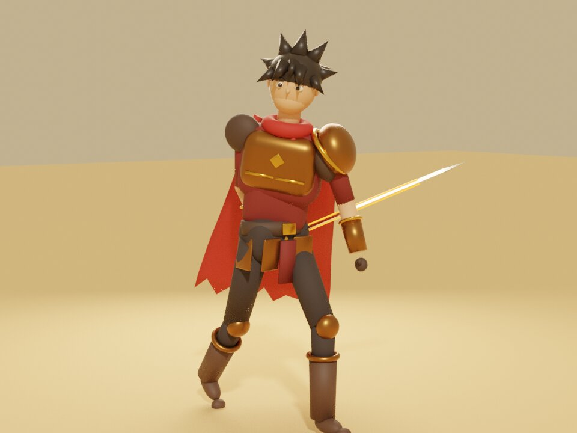

# Kingdoms of the Eight Banners

An original persistent online fantasy MMORPG — third-person 3D exploration, skill-based
real-time combat, player-built cities, rentable shops and a simulated kingdom economy.
PC first, mobile later.

> This is a multi-year vision. The repository is built **one small, tested slice at a time**.
> Current stage: **Phase 1 — offline character prototype** (+ skill tree and a playable browser
> build of the slice). Nothing is online yet.



## What works right now

| Feature | Where |
|---|---|
| **Storm**, an original 3D Warrior made in Blender (rigged; Idle, Walk, Run, Attack, Dodge, Sit, Sleep) | `art/blender/`, `Assets/Art/Characters/Storm/` |
| **Browser prototype** you can play on a phone or PC (Storm, Sunspire City, slimes, quest, HUD, minimap, skill tree) | `web-prototype/` |
| **Skill window**: Warrior - Sunspire City tree, 15 skills in 3 branches, Skill Points, locks, next-level preview | `Assets/Scripts/Core/SkillTree*.cs`, `Assets/Scripts/UI/SkillWindow.cs` |
| Sit (X) and sleep (Z) with faster HP/SP regeneration | `ThirdPersonController.cs`, `PlayerCharacter.cs` |
| Third-person over-the-shoulder camera, mouse orbit, zoom, no wall clipping | `Assets/Scripts/Character/ThirdPersonCamera.cs` |
| WASD camera-relative movement, sprint (drains SP), jump, directional dodge (SP + cooldown + i-frames) | `Assets/Scripts/Character/ThirdPersonController.cs` |
| Seven stats (STR AGI VIT LUCK ELEMENT SENSE DEX) with capped, diminishing-returns formulas | `Assets/Scripts/Core/` |
| Separate character EXP and job EXP tracks | `Assets/Scripts/Core/ExperienceTrack.cs` |
| Light attack (LMB) and **Desert Slash** (key 1) with SP cost, cooldown, crits, damage numbers | `Assets/Scripts/Combat/` |
| HUD: Storm Lv.68, red HP, blue SP, yellow EXP, violet Job EXP, menu buttons, skill bar, chat placeholder | `Assets/Scripts/UI/PlayerHud.cs` |
| One-click greybox scene: Sunspire market square, city wall + south gate, Amber Desert dunes, ruined outpost, test ramps/steps/pillars, training dummies | `Assets/Scripts/Editor/PrototypeSceneBuilder.cs` |
| 29 unit tests for the game rules, runnable in Unity **and** in plain .NET / GitHub Actions | `Assets/Tests/EditMode/`, `client-unity/DotNetTests/` |

## Repository layout

```
docs/                    design docs (start with GAME_DESIGN.md and DEVELOPMENT_CHECKLIST.md)
art/blender/             Storm character script (build_storm_warrior.py), build_storm.sh, Storm.blend
web-prototype/           three.js browser version of the slice (index.src.html + build.py)
client-unity/            the Unity project
  Assets/Scripts/Core/       engine-free game rules (stats, HP/SP, EXP, skills, damage)
  Assets/Scripts/Character/  input, movement, camera, player data
  Assets/Scripts/Combat/     attacks, hit targets, damage numbers
  Assets/Scripts/UI/         HUD
  Assets/Scripts/Editor/     scene generator menu
  Assets/Tests/EditMode/     NUnit tests (Unity Test Runner)
  DotNetTests/               runs the same tests without Unity (CI)
server/                  future authoritative backend (Phase 3+), empty for now
database/                future PostgreSQL migrations and seed data
ops/                     future docker/scripts
```

## Open and play it — step by step (no Unity experience assumed)

### 1. Install the tools (once)

1. Install **Git** — <https://git-scm.com/downloads>.
2. Install **Unity Hub** — <https://unity.com/download>.
3. In Unity Hub → **Installs** → **Install Editor** → pick the newest **Unity 6 LTS**
   (version starts with `6000.`, labelled *LTS*). On the module screen tick
   **Microsoft Visual Studio Community** (Windows) or install **JetBrains Rider** yourself.
   Mobile modules are not needed yet.
4. (Optional now, needed later) Install **Blender** — <https://www.blender.org>.

### 2. Get the project

```bash
git clone https://github.com/waydidi/Battle.git
cd Battle
```

### 3. Open it in Unity

1. Unity Hub → **Projects** → **Add** (▾) → **Add project from disk**.
2. Select the **`client-unity`** folder (not the repository root).
3. If Hub warns about the editor version, choose your installed Unity 6 LTS and click **Open**.
4. The first open takes several minutes (Unity downloads packages and builds `Library/`).
5. If a dialog says *"This project is using the new input system package… enable the backends?"*
   click **Yes**. Unity restarts.
6. Check the **Console** window (*Window → General → Console*). There should be no red errors.
   If Package Manager reports that a package version cannot be found, open
   *Window → Package Manager*, select that package, and click **Update** / **Install** to the
   version your editor offers.

> Unity creates a `.meta` file next to every asset on first open. **Commit those `.meta`
> files** — they hold the IDs that link scenes and scripts together.

### 4. Generate the test scene

1. In the top menu bar click **Kingdoms → Build Prototype Desert Town Scene**.
2. Unity creates `Assets/Scenes/Prototype_DesertTown.unity`, opens it, and adds it to the build
   list. Re-run the menu any time to rebuild it from scratch.

### 5. Play

1. Press the ▶ **Play** button at the top of the editor, then click inside the **Game** view.
2. Controls:

| Action | Input |
|---|---|
| Move | W A S D |
| Look around | Mouse |
| Zoom | Mouse wheel |
| Sprint | hold Left Shift (uses SP) |
| Jump | Space |
| Dodge | Left Ctrl or Q (+ direction; no direction = backstep) |
| Attack | Left mouse |
| Desert Slash | 1 (15 SP, 4 s cooldown) |
| Skill tree | K (or the Skill button, top right) |
| Sit / Sleep | X / Z (move to stand up) |
| Free the mouse | Esc (click the Game view to recapture) |

3. Press ▶ again to stop. *Changes made while playing are lost when you stop* — that is normal.

Things to try: hit the three training dummies, sprint until SP runs out, dodge with an empty
SP bar, walk up the 30° ramp (works) and the 60° ramp (blocked), climb the steps, back the
camera into the pillars and walls (it should slide in front of them, never through).

### 6. Run the tests

- **In Unity:** *Window → General → Test Runner* → **EditMode** → **Run All**.
- **Without Unity** (needs the .NET 8 SDK):
  ```bash
  dotnet test client-unity/DotNetTests/KingdomsCore.Tests.csproj
  ```
  GitHub Actions runs this on every push.

### Optional: switch to URP rendering

The `com.unity.render-pipelines.universal` package is installed. If you created no pipeline
asset, Unity uses the built-in renderer and everything still works. To use URP:
*Assets → Create → Rendering → URP Asset (with Universal Renderer)*, then
*Edit → Project Settings → Graphics* → set **Default Render Pipeline** to that asset, and re-run
**Kingdoms → Build Prototype Desert Town Scene** so materials switch to the URP Lit shader.

### Play the browser prototype (no Unity needed)

```bash
python3 web-prototype/build.py          # writes web-prototype/dist/index.html
```

Open `web-prototype/dist/index.html` in Chrome, Edge, Firefox or Safari (desktop or phone).
Desktop: click the view to steer with the mouse; WASD, Shift sprint, C walk, Space jump,
Q dodge, LMB/J attack, 1 Desert Slash, X sit, Z sleep, E talk, K skills.
Phone: left thumb moves, right thumb turns the camera, buttons on the right fight.
Talk to Elder Saffa in the plaza, then defeat 5 slimes outside the South Gate.

### Rebuild the Storm character (optional)

Install Blender 4.x, then run `./art/blender/build_storm.sh --render`. It regenerates the
Unity FBX, the web GLB, the editable `.blend` and the preview renders. See
[docs/CONTENT_PIPELINE.md](docs/CONTENT_PIPELINE.md).

## Ground rules

- **The server decides, the client displays.** Gold, inventory, damage and movement speed are
  never authoritative on the client. Offline shortcuts are labelled `OFFLINE PROTOTYPE`.
- Game rules go in `Assets/Scripts/Core` (no `UnityEngine` allowed there) so the future server
  can reuse them and CI can test them.
- Only original or properly licensed assets; log every third-party asset in
  [docs/ASSET_LICENSES.md](docs/ASSET_LICENSES.md).
- Prove one enjoyable loop before adding continents, wars or AI secret classes.

## Next task

Open the project in Unity, run **Kingdoms > Build Prototype Desert Town Scene** (it now uses
the Storm model and builds his Animator Controller), press Play and check the Phase 1 exit
test: 60 FPS, no camera clipping, no walking through walls. Then port the slime, quest and
minimap from the web prototype into Unity (sessions 9–14 in
[docs/DEVELOPMENT_CHECKLIST.md](docs/DEVELOPMENT_CHECKLIST.md)).
