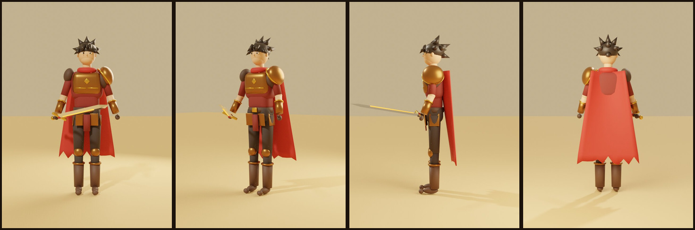
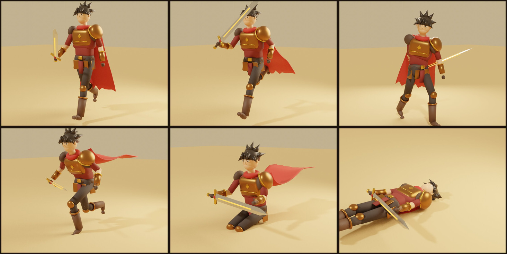

# Content Pipeline

## Art direction

Original, colorful, stylized fantasy 3D. Readable silhouettes. Detailed cities that still run on
mobile. References may inspire mood — never copy assets.

## Tools

Blender (models, rigs, collision meshes) · Krita / GIMP / Substance (textures, UI) ·
Unity URP (rendering) · Git (+ Git LFS once binary assets grow).

## Pipeline

1. Cheap concept art for mood and shape language.
2. Simplified mesh in Blender, **or** buy properly licensed modular packs.
3. UV unwrap; original / reusable textures.
4. Rig and animate (or adapt licensed animation packs).
5. Export FBX/glTF → import to Unity → prefab.
6. LODs, occlusion, lighting, collision, navmesh, materials, batching, texture compression.
7. Test on a low-spec PC and a midrange phone **before** multiplying assets.

Image-generated character sheets are references only — they are not rigged 3D models.

Every third-party asset gets a row in [ASSET_LICENSES.md](ASSET_LICENSES.md) *before* it is committed.

## Vertical slice asset checklist

**Character:** male Warrior, rig; idle / walk / run / sprint / jump / dodge; 3 attacks;
hit / stun / death; armor material variants.

**Sunspire town:** 12–20 modular sandstone pieces, 8–12 market stalls, ~20 props (pots, baskets,
food, fabric, lanterns), city gate, bridge, palms, banners, navmesh and collision.

**Amber Field:** dune terrain, rocks, shrubs, ruins, slime rig + animations, hit/loot VFX,
one ambient track, SFX.

**UI:** portrait, HP/SP/EXP/job EXP bars, chat, quest tracker, skill bar, target bars, minimap,
full map, city inspector, shop rental, build placement, treasury panel.

## Storm, the Warrior (original, generated in Blender)

`art/blender/build_storm_warrior.py` builds Storm entirely from code: stylized body, spiky hair,
bronze armour with a large left pauldron, red scarf and tattered cape, and a sword with a glowing
"sunfire" fuller. It also creates the skeleton (Unity-Humanoid-style bone names) and seven
animations: **Idle, Walk, Run, Attack, Dodge, Sit, Sleep**.

```bash
./art/blender/build_storm.sh --render   # needs Blender 4.x; --render also refreshes docs/images/storm
```

Outputs: `client-unity/Assets/Art/Characters/Storm/Storm.fbx` (Unity),
`web-prototype/assets/Storm.glb` (browser), `art/blender/Storm.blend` (open and edit in Blender),
`docs/images/storm/*.jpg` (turnaround and pose renders).





It is a **stylized placeholder built from primitives**, good enough to judge scale, silhouette,
animation timing and camera framing. A production character (sculpted, retopologized,
hand-painted textures, proper skin weights) replaces it later using the same bone names.

In Unity: re-run **Kingdoms > Build Prototype Desert Town Scene**. When `Storm.fbx` exists it
replaces the capsule and builds `Storm.controller` (also available as
**Kingdoms > Create Storm Animator Controller**): a Speed blend tree (Idle 0 → Walk 2.2 → Run 5 m/s),
`Sitting` / `Sleeping` bools and `Attack` / `Dodge` triggers.

## Swapping the placeholder player for a real character

The Phase 1 player is a capsule. To use a rigged humanoid:

1. Import the licensed model (Rig tab → Animation Type **Humanoid**).
2. Drag it under `Player (Storm)` and delete `Placeholder Body`, `Facing Marker`, `Placeholder Sword`.
3. Make sure the model's feet sit at the Player's origin (y = 0) and it faces +Z.
4. Create an Animator Controller with parameters **Speed** (float), **Grounded** (bool),
   **Jump** and **Dodge** (triggers). Blend idle/walk/run/sprint on Speed
   (0, 2.2, 5.0, 8+ m/s).
5. Assign the controller to the model's Animator. `ThirdPersonController` finds it
   automatically and only drives parameters that exist. Leave **Apply Root Motion** off.
